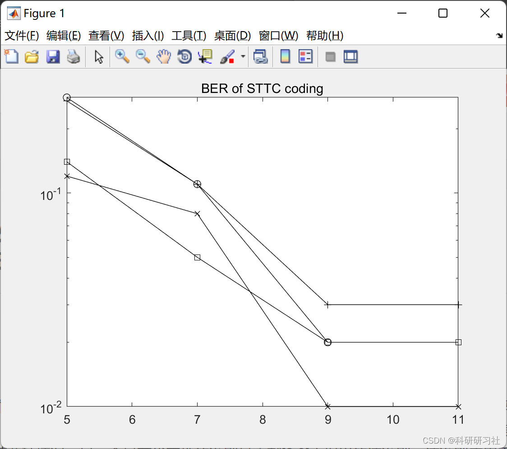

# Signal Processing: Antenna Diversity and Space-Time Coding Technologies - Space-Time Codes (MATLAB Code Implementation)

​  
1. Overview of Space-Time Code as a Type of Spatial-Temporal Coding Technology Classical design criteria are proposed by [1] the rank-determinant criterion and distance-product criterion, which are applied to slow fading and fast fading respectively. Another representative criterion is the trace criterion proposed in documents [2,3], which applies to systems with a large product of the number of transmitting and receiving antennas. Both slow fading and fast fading trace criteria have the same form. The above criteria assume a flat fading channel in the derivation, whereas actual broadband wireless channels are typically frequency selective fading (frequency-selective fading). Therefore, the study [4,5] on the design criteria for space-time block codes in frequency-selective fading channels involves extending the two criteria from [1] under multipath frequency-selective fading conditions. The results obtained are phenomenologically similar to those under flat fading.
2. Running Results Editing
3. Matlab code: This article only displays a portion of the code, all codes can be accessed by clicking the link.
Signal Processing: Antenna Diversity and Space-Time Coding Technologies - Space-Time Codes (MATLAB Code Implementation)
function [data_est,state_est] = STTC_detector(sig,dlt,slt,ch_coefs)\n\n\n\n[step_final,space_dim,N_packets] = size(sig);\n[s,md,foo] = size(dlt);\nqam16=[1 1;2 1;3 1;4 1;4 2;3 2;2 2;1 2;1 3;2 3;3 3;4 3;4 4;3 4;2 4;1 4];\nfor k = 1:N_packets\n   metric(1,2:s) = realmax;\n   for l = 1:step_final\n\t  for m = 1:s % current m\n         [s_pre,foo] = find(slt==m);\n\t\t pos = mod(m-1,md) + 1;\n\t\t data_test = dlt(s_pre,pos,:);\n\t\t data_test = reshape(data_test,[md 2]);\n\t\t if md==16 % 16QAM\n\t\t   for r = 1:2\n\t\t\t  k1(:,r) = qam16(data_test(:,r)+1,1);\n\t\t\t  k2(:,r) = qam16(data_test(:,r)+1,2);\n           end\n\t\t   q_test = (2*k1-md-1) - j*(2*k2-md-1);\n\t\t  else % 4,8PSK\n\t\t   expr = j*2*pi/md;\n\t\t   q_test = exp(expr*data_test);\n         end\n\t\t metric_d = branch_metric(sig(l,:,k),q_test,ch_coefs(:,:,k));\n\t\t metric_md = metric(l,s_pre)' + metric_d;\n\t\t [metric_min,metric_pos] = min(metric_md);\n\t\t metric(l+1,m) = metric_min;\n\t\t vit_state(l+1,m) = s_pre(metric_pos);\n\t\t vit_data(l+1,m) = pos - 1;\n      end\n   end\n   [foo,state_best] = min(metric(end,:));\n   state_est(step_final + 1) = state_best;\n   for l = step_final:-1:1\n\t  state_est(l) = vit_state(l+1,state_est(l+1));\n\t  data_est(l,:,k) = vit_data(l+1,state_est(l+1));\n   end\nend\n  
🎓 Blogger's Extracurricular Interest: Eastern and Western Philosophy, Gift to Readers: 👨‍💻 Doing research involves a deep philosophical system that requires researchers to be logically precise and diligent. However, it is not just about hard work; sometimes, leveraging others' efforts can be more important. Additionally, there should be an innovative point and inspirational point of looking up at the stars. When your teacher asks you in philosophy class what science is and what electricity is, don't think these questions are funny. Philosophy seeks ultimate questions, seeking those questions that only children ask but you cannot answer. In this column, I record some philosophical thoughts and scientific notes when I have time: Research and Thought. It is recommended that readers read the articles in order according to the directory, so as not to suddenly fall into a dark labyrinth without knowing how to get back. It may not reveal all the answers to all questions, but if it can raise a cloud of doubt in one's heart, it might also create a different scene of a beautiful sunset. If it brings a heavy rain of spiritual world trouble, then take the opportunity to wash away the dust on the "truth" that was originally stored there.
Maybe, after the rain, the clear sky of the universe will become even clearer...🔎🔎🔎4 References
[1] Geng Jia, Cao Xiuying, Bi Guangguo. The Proof of Space-Time Coded Trajectory Criterion under Frequency Selective Fading Channel [J]. Journal of Electronics and Information, 2007, 29(4): 938-941
[2] Cheng Jian, Chen Ming, Chen Shixin. Performance Criteria for Optimizing Space-Time Coded and Concatenated Convolutional Codes [J]. Journal of Applied Sciences, 2002, 20(2): 129-134
[3] Geng Jia, Cao Xiuying, Bi Guangguo. Improvement of Space-Time Coded Trajectory Criterion [J]. Journal of Circuits and Systems, 2008, 13(6): 52-57

## Images

<!-- PAYMENT_BLOCK -->

## Get this dataset

- Payment link (Stripe): [Buy now](https://buy.stripe.com/3cs8yP7sY87d0vu9AB)
- Payment QR code: 

<!-- /PAYMENT_BLOCK -->
